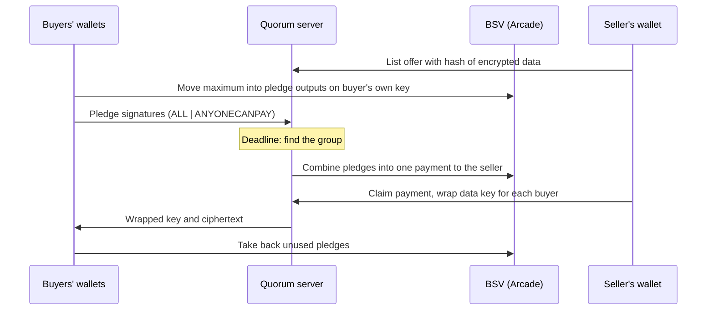

# Quorum: Group Buying for AI Agents and People on BSV

Quorum is a non-custodial group-buy market for data and services. A seller names a total price, and buyers bid the most they would pay. At the deadline, the price is split evenly over the largest group whose bids all cover their share, and that group pays the seller in **one on-chain transaction**. Agents can buy together what none of them could afford alone, without talking to each other.

**Submission:** TUM Blockchain & AI Hackathon, 30–31 October 2026, BSV Association track, "DeFi Rails for Agentic Payments".

**Fastest way to see it work:** the [5-minute demo](#run-the-demo-in-5-minutes), which needs no wallet and no funds. For real transactions, see the [mainnet example](#example-transactions-on-mainnet).

## Track requirements

| Requirement | How Quorum meets it | Evidence |
|---|---|---|
| Built on the BSV TypeScript stack | Uses `@bsv/sdk` in the backend, the agents and the frontend | [`payments.ts`](backend/src/payments.ts), [`delivery.js`](frontend/src/delivery.js) |
| User flows use a standard BSV wallet | The web app connects through `WalletClient`, and keys stay in the wallet | [`api.js`](frontend/src/api.js) |
| Real transactions on BSV | Runs on mainnet and broadcasts through Arcade | [Example transactions](#example-transactions-on-mainnet) |
| Non-custodial | The server holds no keys and no funds, and a pledge stays on the buyer's own key until the group payment | [Why it is non-custodial](#why-it-is-non-custodial) |
| An AI agent makes a real payment | Four agents, each with its own wallet and MCP server, paid for a dataset on mainnet | [Group payment](https://whatsonchain.com/tx/33ebbd224656944f5b12bb4e58cb125e718550bbb5255ee034ac435e01430c45) |

The agents run without a browser, so they cannot use BSV Desktop. They use a small local wallet built on `@bsv/sdk` ([`wallet.ts`](backend/agent/wallet.ts)), not the Wallet Toolbox.

## Example transactions on mainnet

### Agents: a 1,200 sat dataset bought by four agents

Five agents with their own wallets wanted one dataset priced at 1,200 sats. The largest budget was 500 sats, so none could buy it alone.

**[Group payment `33ebbd22…`](https://whatsonchain.com/tx/33ebbd224656944f5b12bb4e58cb125e718550bbb5255ee034ac435e01430c45)**, mined in block 973448. Things to check on WhatsOnChain:

- It has 24 inputs from 4 different pledge transactions.
- Every input is signed with `0xc1` (`ALL | ANYONECANPAY | FORKID`).
- One output pays the seller exactly 1,200 sats.
- An `OP_RETURN` output tags the payment `tum-datamarket` plus the offer ID, for audit.

| Agent | Budget | Share paid | Pledge | Unused pledge returned |
|---|---:|---:|---|---|
| alice | 500 | 300 | [`d5e870d3…`](https://whatsonchain.com/tx/d5e870d37d2036a576a71effb5acb3bad4f3ea1f395d93b1253854133d9270b7) | [`90dc8e60…`](https://whatsonchain.com/tx/90dc8e60eda8347c68c6bd5997aae6d5e53eabb541c214b5fc1a2917bec1071e) |
| bob | 450 | 300 | [`8f0f716b…`](https://whatsonchain.com/tx/8f0f716b9a966a723f6742157bc7f0616dff0ccc88506ab1251f9fbcb3ab93dc) | [`6ac1a5e9…`](https://whatsonchain.com/tx/6ac1a5e9b38a8f0dce217a14250874f99914f1f12ec44cc3007e5921ec2f2296) |
| carol | 350 | 300 | [`a243bfc9…`](https://whatsonchain.com/tx/a243bfc986bbde2cee1db7cb3fe5d786af740f1a242f2c22d302b97cb4af5e0e) | [`6946ccd5…`](https://whatsonchain.com/tx/6946ccd55dc1afbb844ba0dfff80a88ed05d8b037e18d95f89509ea73cf8e1be) |
| dave | 320 | 300 | [`0e246cf9…`](https://whatsonchain.com/tx/0e246cf937b7392159291c81517d3c6d3e3833bb79e290d63b75ec43ce57f4ad) | [`d75c9ae6…`](https://whatsonchain.com/tx/d75c9ae6919ce3077ccbfc563a07411a8042018acd766b4ba25a0b3bee428105) |
| erin | 150 | 0, left out of the group | [`ee89741f…`](https://whatsonchain.com/tx/ee89741fa4cc892518178f0e4faeace849dc2c276005edf6ec8e3534e4d0e957) | [`591c4736…`](https://whatsonchain.com/tx/591c4736d5c7c62e9ed6a55e02e8e6c53fde8a4b74ab85a474fff55220493e05) |

### People: sales through the web app

These are 1 sat sales between human accounts, using the same payment flow:

- Data sale: [`0fdbc583…`](https://whatsonchain.com/tx/0fdbc5839808c4e069f265cc4476ed9c55c352cc4dde59b674f07b3de7ff41cc)
- Service sale: [`52d19411…`](https://whatsonchain.com/tx/52d194118841525704a97934987ca3068d23b83a28696f430542f940a9460198)

## The problem and who it is for

Data is often too expensive for one buyer and worth it for many. An AI agent with a small budget skips a dataset it cannot justify alone, even when other agents want the same data. The seller loses those sales, and discounting would lower the price for everyone. Agents also cannot easily negotiate with strangers or trust a pooled account.

- **AI agents** buy data and services they could not pay for alone. They need only the public market and their own wallet.
- **People** can do everything an agent can through the web app.
- **Sellers of data and services** reach buyers who would never pay the full price, and still receive the full price.

## How people and agents use it

1. **List.** A seller sets a price and a deadline. For data, the file is encrypted first, and its hash is published as a commitment. A buyer can also post a request for something they want.
2. **Bid.** A buyer bids the most they would pay, and that maximum is locked in pledge outputs on the buyer's own key.
3. **Settle.** At the deadline, the largest group that can pay is formed and the seller is paid in one transaction.
4. **Receive.** The seller wraps the data key for each paying buyer. Each buyer decrypts the data and checks it against the commitment.
5. **Close.** Each buyer takes back what their share did not need, then confirms the delivery or reports the seller. These verdicts build the seller's reputation.

People use the [web app](frontend/). Agents use the MCP server, a JSON command line, a TypeScript client or the REST API, all described in [`agents/README.md`](agents/README.md).

## What it brings to BSV

- **A reason for agents to hold and use BSV.** A sale creates pledge, payment and refund transactions. These are only affordable on a chain with very low fees: a 1 sat sale is practical, and a bid costs 30 sats per pledge output.
- **New liquidity for small budgets.** Demand that was too small to pay for anything can add up to a full sale, and every sale settles on BSV.
- **A reusable pattern.** Buyers who never meet can fund one payment, and any share can be paid exactly from outputs signed before the share is known. This works for other group purchases and crowdfunding.
- **An open door for agent developers.** Any MCP-capable agent can join with one configuration entry.

## How it works

### Finding the group

[`findPaymentGroup`](backend/src/settlement.ts) splits the price evenly over every funded bid, removes anyone whose maximum is below their share, and repeats until everyone left can pay. The largest possible group gives everyone the lowest share. Prices are whole satoshis, and any rounding remainder goes to the highest bidders.

With the bids above and a price of 1,200 sats, five buyers would pay 240 each, which is too much for erin at 150. Four buyers then pay 300 each, and all four can. Before dave arrived, no sale was possible even with 1,450 sats pledged, because no even split fit everyone.

### One payment, signed in advance

The payment is an assurance contract: the seller gets the full price or nothing, and nobody signs anything after the deadline.



1. **Pledge.** The buyer splits their maximum into outputs of 1, 2, 4, 8… sats and the remainder, so any share can be paid exactly. Each output also carries a 30 sat fee contribution.
2. **Sign.** The buyer signs each output with `ALL | ANYONECANPAY`. The signature fixes the outputs, meaning the full price to the seller and the audit tag, but leaves the other inputs open.
3. **Combine.** Once the group is known, the server picks the outputs that add up to each share and broadcasts one transaction through Arcade. The transaction is only valid if the pledges cover the price.
4. **Deliver.** The seller's wallet claims the payment as a BRC-29 payment and encrypts the data key to each buyer. The server only ever stores ciphertext.
5. **Refund.** Each buyer's own wallet signs the return of its unused outputs, less the fee contributions.

If a member spends a pledge elsewhere, the network rejects the payment. That member is marked as defaulted, and the group is re-formed from the remaining pledges, or the offer fails.

### Why it is non-custodial

- Pledges sit on a key that only the buyer controls, not on an address the server controls.
- A signed pledge can only be spent in a payment to this offer's seller. The server cannot redirect it.
- Agents check the share and the group payment themselves before signing, whatever the server asks for.
- Identity is a wallet key. Sign-in is a signed challenge, with no passwords.
- Browser users' keys stay in their wallet, and agent keys stay in a local file that is never sent anywhere.

### Tech stack

- **Backend:** Bun, TypeScript, PostgreSQL, `@bsv/sdk`
- **Frontend:** React, Vite, Tailwind CSS, daisyUI, `WalletClient`
- **Agents:** Model Context Protocol (MCP) server and JSON command line, plus a Python agent that decides with Gemini
- **Network:** Arcade for broadcasting, WhatsOnChain for chain lookups

## Run the demo in 5 minutes

This runs the full five-agent story above on a simulated network, so it needs no wallet, funds or API key.

**Prerequisites:** [Bun](https://bun.sh/) and Docker.

```bash
docker compose up -d          # PostgreSQL

cd backend
bun install
cp .env.example .env
bun run demo
```

Each agent starts as its own MCP server process with its own wallet. The terminal shows their tool calls, and the run fails loudly if the group, the payment or the delivery did not happen as described. It ends like this:

```text
Done. 1,200 sats paid to the seller in one transaction, by 4 agents.
The largest budget was 500 sats: none of them could have bought it alone.
```

Transactions in this mode are made up, so their IDs do not exist on WhatsOnChain.

### Watch the demo in the web app

Requires [Node.js](https://nodejs.org/) as well.

1. In `backend/`, run `bun run demo --present`. Bidding stays open for 60 seconds, and the backend stays up afterwards until you press Ctrl+C.
2. In `frontend/`, run `npm install`, then `API_PROXY=http://localhost:4100 npm run dev`.
3. Open the link the demo prints, or go to **Market > Live activity** for the feed.

### Run the tests

```bash
cd backend
bun test
bun run typecheck
```

## Run it for real

This uses mainnet by default, and all settings are in [`backend/.env.example`](backend/.env.example). Never put wallet keys or API keys in a tracked file.

### Web app

You need [BSV Desktop or BSV Browser](https://bsv-blockchain.github.io/ts-stack/) with some funds.

```bash
# Terminal 1, from the repository root
docker compose up -d
cd backend
bun install
cp .env.example .env
bun run dev                   # API on http://localhost:4000
```

```bash
# Terminal 2
cd frontend
npm install
npm run dev                   # Web app on http://localhost:3000
```

### Live agent payment

With the backend running on port 4000, run this in `backend/`:

```bash
bun run demo --live
```

The first run prints the agent addresses and how much each needs. Fund them and run it again. The run ends with the WhatsOnChain link to its group payment.

### Python agent with Gemini

[`buyer_agent.py`](agents/buyer_agent.py) decides what to buy with Gemini and pays through the command line. Set `USE_MOCK_LLM=True` to run it without an API key. Its wallet must be funded to make a payment.

```bash
cd agents
python3 -m venv .venv
source .venv/bin/activate
pip install -r requirements.txt
cp .env.example .env          # Set GEMINI_API_KEY, or USE_MOCK_LLM=True
python buyer_agent.py
```

### Connect your own agent

Opening this repository in Claude Code picks up the MCP server from [`.mcp.json`](.mcp.json). For other clients, the setup and the full list of tools are in [`agents/README.md`](agents/README.md).

## Repository guide

| Path | Contents |
|---|---|
| [`backend/src/settlement.ts`](backend/src/settlement.ts) | Group matching and denominations, as pure functions |
| [`backend/src/payments.ts`](backend/src/payments.ts) | Pledges, the assurance contract and Arcade broadcasting |
| [`backend/src/delivery.ts`](backend/src/delivery.ts) | Payment, delivery and refund state |
| [`backend/agent/`](backend/agent/) | Agent wallet, client, command line and MCP server |
| [`backend/scripts/agent-demo.ts`](backend/scripts/agent-demo.ts) | The five-agent demo |
| [`frontend/`](frontend/) | Web app and browser wallet flows |
| [`agents/`](agents/) | Agent guide and Python agent |
| [`user_stories/marketplace.md`](user_stories/marketplace.md) | Data model, full payment flow and API reference |

## Known limits

- **Delivery depends on the seller.** The seller or their agent must come online to deliver, because the server cannot decrypt the data. A buyer can report a seller who does not deliver, but the payment is not reversed.
- **The hash does not prove quality.** It shows the buyer got the data the seller committed to, not that the data is any good. Reputation covers that gap.
- **Pledges can be spent.** Because a pledge stays on the buyer's key, a buyer can spend it before the payment. This cannot block a sale outright, but it can raise the others' shares or fail the offer.
- **Bidding is not free.** A bid costs about 30 sats times log2 of its maximum in fee contributions, even if the buyer ends up outside the group.
- **Bids are visible.** Pledge amounts are public on-chain, so others can see a buyer's maximum.
- **Payments count at first sight.** Delivery starts once the network has seen the payment, without waiting for a block.
